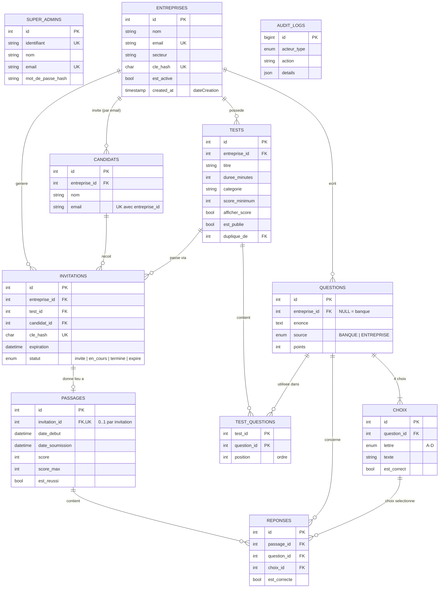

# Base de données PsyTech Pro (v3 — alignée sur le diagramme de classes)



## Correspondance diagramme de classes -> tables
| Classe | Table | Remarque |
|---|---|---|
| SuperAdmin | `super_admins` | `identifiant` sert au login |
| Entreprise | `entreprises` | `estActive` = `est_active`, `dateCreation` = `created_at` |
| Candidat | `candidats` | unique par (entreprise, email) |
| Invitation + `StatutInvitation` | `invitations` + ENUM `statut` | |
| Passage | `passages` | créé au démarrage du test; score/date_soumission remplis à la soumission |
| Test | `tests` | `estPublie` = `est_publie` |
| Question + `SourceQuestion` | `questions` + ENUM `source` | `entreprise_id` NULL <=> `BANQUE` |
| Choix | `choix` | 4 par question, 1 seul `est_correct` |
| TestQuestion | `test_questions` | `ordre` = `position` |
| Reponse | `reponses` | `est_correcte` copié depuis `choix.est_correct` |
| JournalActivite | `audit_logs` | |
| Statistiques / StatistiquesEntreprise | (pas de table) | calculées: `/admin/stats`, `v_dashboard_entreprise` |
| FormatExport | (pas de table) | enum du code (CSV / PDF) |

Vue `v_questions`: question + ses 4 choix "à plat" (`option_a..d`, `reponse_correcte`) — c'est elle que le code lit.

## Qui utilise quoi
| Module | Tables principales |
|---|---|
| Super Admin | `super_admins`, `entreprises`, `questions`/`choix` (source BANQUE), `audit_logs`, stats sur tout |
| Entreprise (RH) | `tests`, `questions`/`choix` (les siennes), `test_questions`, `candidats`, `invitations`, vues `v_tests_resume`, `v_resultats_detail`, `v_dashboard_entreprise` |
| Candidat | `invitations` (login par clé), `passages`, `reponses`, `v_questions` (sans la bonne réponse) |

## Requêtes utiles
**Questions d'un test, dans l'ordre** (sans la bonne réponse pour le candidat !):
```sql
SELECT q.id, q.enonce, q.option_a, q.option_b, q.option_c, q.option_d
FROM test_questions tq JOIN v_questions q ON q.id = tq.question_id
WHERE tq.test_id = ? ORDER BY tq.position;
```
**Enregistrer/changer une réponse** (le candidat peut revenir en arrière):
```sql
INSERT INTO reponses (passage_id, question_id, choix_id, est_correcte) VALUES (?, ?, ?, ?)
ON DUPLICATE KEY UPDATE choix_id = VALUES(choix_id), est_correcte = VALUES(est_correcte);
```
**Calcul du score à la soumission:**
```sql
SELECT COALESCE(SUM(CASE WHEN rp.est_correcte = 1 THEN q.points END), 0) AS score,
       COALESCE(SUM(q.points), 0) AS score_max
FROM test_questions tq
JOIN questions q ON q.id = tq.question_id
LEFT JOIN reponses rp ON rp.question_id = q.id AND rp.passage_id = ?
WHERE tq.test_id = ?;
```
**Login candidat** (clé valide, non expirée, entreprise active) — voir `INVITATION_SQL` dans `src/middlewares/auth.js`.
La clé reçue est hashée avec `hashKey()` de `src/utils/keys.js` avant la requête.
